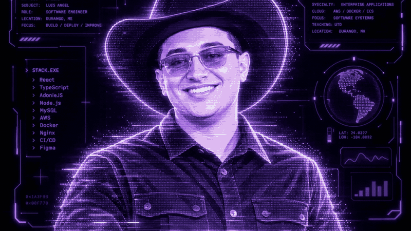

LUIS ÁNGEL MARTÍNEZ VARGAS
SOFTWARE ENGINEER · FULL-STACK DEVELOPER · CLOUD & ENTERPRISE SYSTEMS

> whoami
Full-stack software engineer building enterprise applications, cloud-connected systems and practical tools that streamline real operations. I work across application design, API development, databases, infrastructure and deployment.
CURRENT MODE      Building · Deploying · Teaching
FRONTEND          React · TypeScript · Vite · Ant Design
BACKEND           Node.js · AdonisJS · Express
DATA              MySQL · MariaDB
INFRASTRUCTURE    AWS · ECS · Docker · Nginx · GitHub Actions
INTERESTS         Architecture · Automation · Security · UX
> selected_projects
Project	Focus	Stack
Enterprise Operations Platform	Logistics workflows, inspections, maintenance and operational reporting	React · TypeScript · AdonisJS
Cloud Infrastructure & Delivery	Container deployment, CI/CD, monitoring and backups	AWS · Docker · GitHub Actions
Smart Device Study Guide	Interactive educational resources and exam preparation	Web · UX · Learning
Security Research	Defensive OSINT, secure development and technical documentation	Linux · Security

Some professional projects are private; descriptions do not expose internal source code or credentials.
> toolchain

SYSTEM STATUS: BUILDING WHAT'S NEXT

Durango, México · Engineering with purpose

